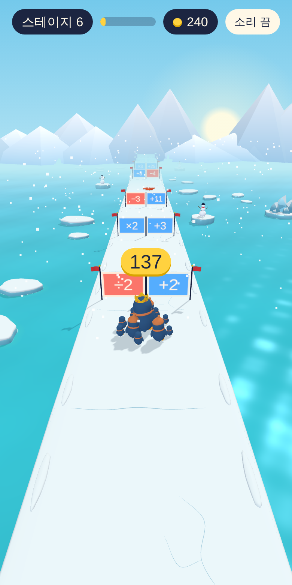
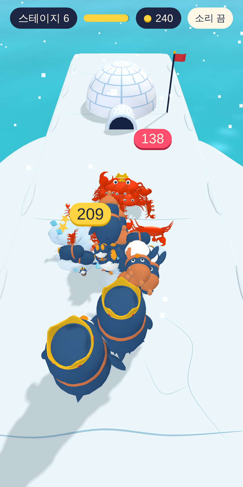

# 뭉쳐 달려 (crowd-runner)

숫자 게이트를 골라 펭귄 무리를 불리고, 스테이지 끝의 게 무리를 이기는 3D 러너 게임입니다. 브라우저에서 바로 실행되며 PC와 휴대폰 모두에서 플레이할 수 있습니다.

<p align="center">
  
  
</p>

## 플레이하기

빌드 과정이 없습니다. 저장소를 내려받아 `index.html`을 열면 됩니다.

- **내 컴퓨터에서**: `index.html`을 브라우저로 엽니다. `style.css`와 `js` 폴더가 같은 위치에 있어야 합니다.
- **깃허브 페이지로**: 저장소의 Settings → Pages에서 `main` 브랜치를 선택하면 `https://<사용자 이름>.github.io/crowd-runner/` 주소로 플레이할 수 있습니다.

3D 라이브러리와 글꼴을 CDN에서 받아오므로 인터넷 연결이 필요합니다.

### 조작

- 좌우로 드래그(터치 또는 마우스)
- 키보드 ← → 또는 A D

## 게임 규칙

펭귄 무리는 자동으로 앞으로 달립니다. 좌우로 움직여 게이트를 고르고 장애물을 피합니다.

- **게이트**: `+n`, `×n`, `−n`, `÷n`이 두 개씩 놓여 있고, 무리의 중심이 지나간 쪽이 적용됩니다.
- **합체**: 같은 크기 10마리가 모이면 한 단계 큰 펭귄 하나가 됩니다. 꼬마(1) → 털모자를 쓴 큰 펭귄(10) → 왕관을 쓴 대장(100) → 망토를 두른 황제(1,000). 무리는 인원수의 자릿수대로 그려지며, 인원수 자체는 달라지지 않습니다. 게 무리도 같은 방식입니다.
- **게 무리**: 만나면 서로 한 마리씩 줄어듭니다. 스테이지 끝의 보스 무리보다 인원이 많아야 이깁니다.
- **장애물**: 회전하는 고드름 막대, 얼음 구멍, 움직이는 얼음 벽. 꼬마 펭귄은 닿으면 사라지고, 큰 펭귄은 닿으면 자기 가치의 약 30%를 잃습니다(큰 펭귄 3, 대장 30, 황제 300).
- **별**: 클리어하면 1개입니다. 실수 없이 했을 때 남는 인원을 기준으로, 그 40% 이상이 남으면 2개, 75% 이상이 남으면 3개입니다.
- **코인과 업그레이드**: 코인으로 시작 인원(한 번에 +1명, 최대 31명)과 코인 수익(한 번에 +20%)을 올립니다. 이미 깬 스테이지를 다시 깨면 코인은 절반만 받습니다.
- **탐험 지도**: 깬 스테이지를 다시 고르거나 별과 최고 기록을 볼 수 있습니다. 10스테이지마다 구역이 바뀝니다.

진행 상황은 브라우저(localStorage)에 저장됩니다. 다른 기기나 다른 브라우저로는 옮겨지지 않습니다.

## 스테이지와 난이도

스테이지는 번호만으로 자동 생성됩니다. 같은 번호는 언제나 같은 구성이 나오고, 항상 클리어할 수 있게 만들어집니다. **끝은 없습니다.** 다만 19스테이지부터는 난이도가 더 오르지 않고 구성만 달라집니다.

| 요소 | 변화 |
|---|---|
| 길이 | 구간 5개에서 시작해 12스테이지부터 14개 |
| 장애물 | 고드름 막대는 2스테이지, 얼음 구멍은 3스테이지, 얼음 벽은 5스테이지부터 등장 |
| 보스 무리 | 실수 없이 했을 때 인원의 50%(1~3스테이지), 4스테이지에 75%, 이후 스테이지마다 1%p씩 늘어 19스테이지부터 90% |

게이트 쌍의 절반 이상은 덧셈 대 곱셈, 또는 뺄셈 대 나눗셈으로 맞붙습니다. 두 결과의 차이가 10~25%에 불과해서 지금 인원에 따라 답이 달라집니다. `+400`과 `+500`처럼 같은 연산끼리 맞붙는 쌍은 나오지 않습니다.

## 프로젝트 구조

| 파일 | 역할 |
|---|---|
| `index.html` | 화면 구조, 스타일과 스크립트 불러오기 |
| `style.css` | 디자인 전체 |
| `js/core.js` | 공통 도우미와 상수, 진행 상황 저장(`Save`), 스테이지 자동 생성(`genLevel`) |
| `js/renderer.js` | 3D 화면, 카메라, 조명, 그림자, 느린 기기용 품질 조절 |
| `js/characters/` | 펭귄과 게의 원본 모델, 단계별 차림, 동작 |
| `js/characters.js` | 원본 모델을 게임용으로 가볍게 바꾸고 동작을 미리 계산(`CharacterModels`) |
| `js/crowd.js` | 무리의 대형, 합체와 분리, 전투 중 움직임(`CrowdView`), 화면 효과(`Fx`) |
| `js/environment/ice-models.js` | 얼음길과 유빙의 원본 모델 |
| `js/environment.js` | 길 만들기, 유빙 배치와 움직임 |
| `js/water.js` | 바다와 거품 |
| `js/scene.js` | 게이트, 장애물, 눈사람, 이글루 배치(`buildLevel`), 설산, 눈발 |
| `js/audio.js` | 효과음(`Sfx`) |
| `js/combat.js` | 전투 효과, 박자, 화면 흔들림(`Combat`) |
| `js/game.js` | 게임 진행, 결과와 업그레이드, 충돌 판정(`step`), 카메라와 화면 갱신(`frame`) |
| `js/map.js` | 별 계산과 탐험 지도(`renderMap`) |
| `js/main.js` | 입력 처리와 시작. 가장 마지막에 불러옵니다 |
| `tests/` | 개발용 자동 검사 |
| `docs/` | 자세한 문서와 스크린샷 |

스크립트는 모듈이 아닌 일반 스크립트이며 `index.html`에 적힌 순서대로 불러옵니다. 파일 최상위에 선언한 이름은 파일끼리 공유됩니다. 모듈을 쓰지 않은 것은 `index.html`을 컴퓨터에서 직접 열어도 실행되게 하기 위해서입니다.

기기가 느리면 실시간 그림자가 자동으로 꺼집니다.

## 개발

게임 실행에는 필요 없고, 검사를 돌릴 때만 Node.js가 필요합니다.

```sh
npm install
npm test
```

자주 손대는 곳은 다음과 같습니다.

| 바꾸고 싶은 것 | 위치 |
|---|---|
| 스테이지 길이, 장애물 등장 시점, 보스 비율, 게이트 쌍 규칙 | `js/core.js`의 `genLevel` |
| 별 기준 | `js/map.js`의 `starsFor` |
| 합체 단계와 크기 | `js/crowd.js`의 `TIER_VALUE`, `TIER_SCALE` |
| 유빙의 크기와 간격 | `js/environment.js`의 `FLOE_LAYOUT` |
| 전투 간격과 전투 시간 | `js/game.js`의 `lineGap`과 `step` 안의 `f.rate` |

`genLevel`을 바꾸면 모든 스테이지의 구성이 달라집니다. 스테이지 구성은 저장하지 않고 매번 번호로 다시 만들기 때문입니다. 저장된 별과 최고 기록은 그대로 남습니다.

## 자세한 문서

- [캐릭터 모델](docs/characters.md): 생김새, 동작, 많은 캐릭터를 그리는 방법
- [전투 연출](docs/combat.md): 전선, 쓰러지는 연출, 효과, 카메라, 전투 시간
- [얼음 환경과 바다](docs/environment.md): 길, 유빙 배치와 조절, 바다, 조명
- [검사](docs/testing.md): 검사 실행 방법과 검사 내용

## 사용한 것

- [Three.js](https://threejs.org/) 0.149.0 (MIT 라이선스)
- 글꼴 [Jua](https://fonts.google.com/specimen/Jua), [Noto Sans KR](https://fonts.google.com/noto/specimen/Noto+Sans+KR) (SIL Open Font License)
